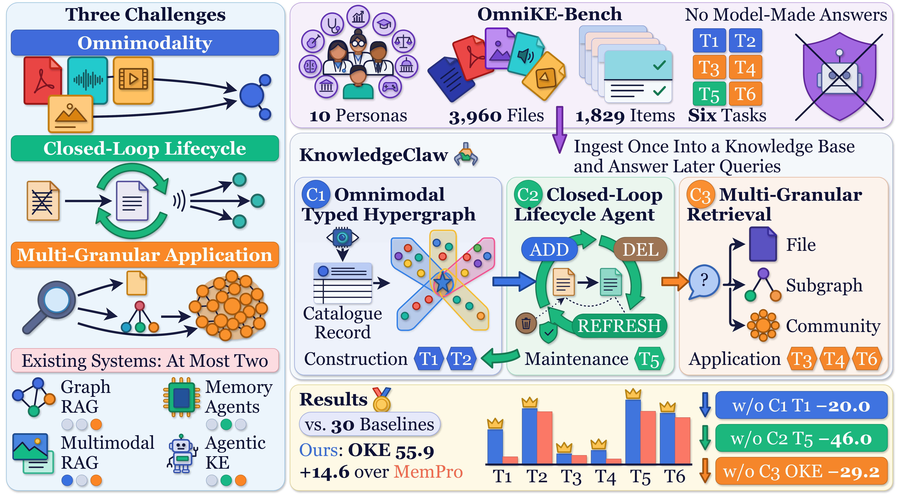

# KnowledgeClaw

KnowledgeClaw: Towards Agentic Knowledge Engineering via Omnimodal Hypergraphs

## Overview



## Quick Start

### 1. Environment Setup

```bash
conda create -n knowledgeclaw python=3.12
conda activate knowledgeclaw

pip install -r requirements.txt
conda install -c conda-forge ffmpeg -y      # ffmpeg + ffprobe, used to read audio and video natively
```

All model calls go through an OpenAI-compatible endpoint (default: [OpenRouter](https://openrouter.ai/)), with Gemini 2.5 Flash Lite (`google/gemini-2.5-flash-lite`) as the backbone and Gemini Embedding 2 (`google/gemini-embedding-2-preview`) as the encoder. Get an [OpenRouter](https://openrouter.ai/) API key and export it:

```bash
export MODEL_API_KEY="your_openrouter_key_here"
# optional: export MODEL_BASE_URL=...   (default https://openrouter.ai/api/v1)
```

### 2. Data Preparation

Download OmniKE-Bench from Hugging Face into `dataset/` (or point `DATA_DIR` to another location):

```bash
pip install -U huggingface_hub
hf download LHRLAB/KnowledgeClaw --repo-type dataset --local-dir dataset
```

```text
dataset/
├── corpus/<persona>/{text,pdf,image,audio,video}/   # base corpus of each persona
├── corpus/<persona>/deltas/                         # next versions committed in T5
├── release/
│   ├── CORPUS.json                                  # evaluated files of each persona
│   ├── questions/<task>/<persona>.jsonl
│   └── gold/<task>/<persona>.jsonl
└── bridge/                                          # text projection of image / audio / video (read by evaluation/data.py)
    ├── gpt/image/<persona>/<stem>.json              # image description (field "description")
    └── mimo/{audio,video}/<persona>/
        └── <stem>.consolidated.json                 # 30 s windows (field "windows": t0, t1, text)
```

### 3. Implementation

```bash
python -m evaluation.run
```

This builds KnowledgeClaw over each persona's corpus, answers T1–T6 and prints the KnowledgeClaw scores on T1–T6. Predictions and artefacts are written to `results/knowledgeclaw/<persona>/`; model calls are cached in `results/.cache/`, so an interrupted run resumes where it stopped.

## BibTeX

If you find this work is helpful for your research, please cite:

```bibtex
@article{luo2026knowledgeclaw,
 title = {KnowledgeClaw: Towards Agentic Knowledge Engineering via Omnimodal Hypergraphs},
 author = {Luo, Haoran and Wang, Jiapu and Luo, Linhao and Luu, Anh Tuan},
 journal = {arXiv preprint},
 year = {2026}
}
```

For further questions, please contact: haoran.luo@ntu.edu.sg.

## Acknowledgment

This repo benefits from [LLM Wiki](https://gist.github.com/karpathy/442a6bf555914893e9891c11519de94f), [OpenClaw](https://github.com/openclaw/openclaw), [HyperGraphRAG](https://github.com/LHRLAB/HyperGraphRAG), and [M³KG-RAG](https://kuai-lab.github.io/cvpr2026m3kgrag/). Thanks for their wonderful works.
